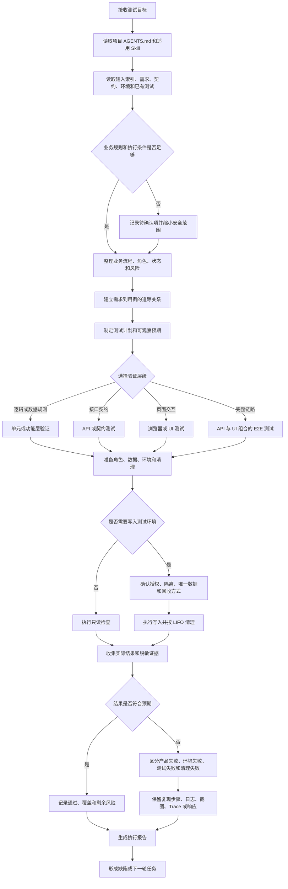
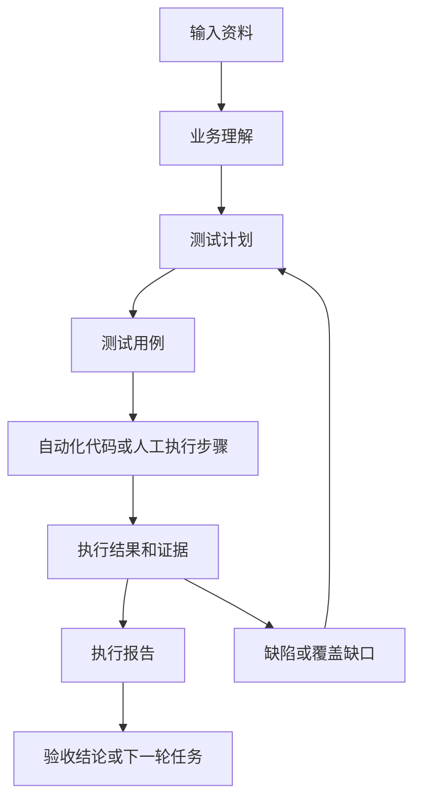
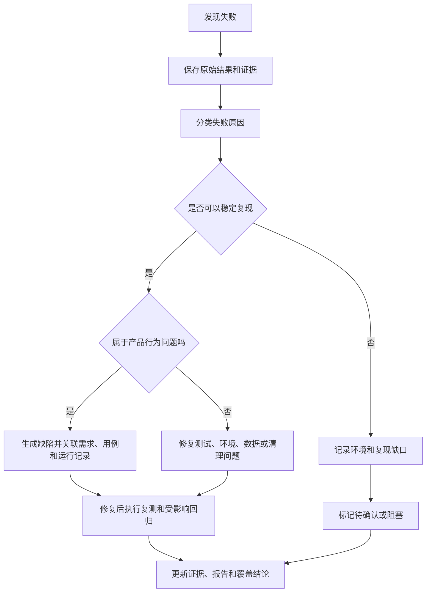
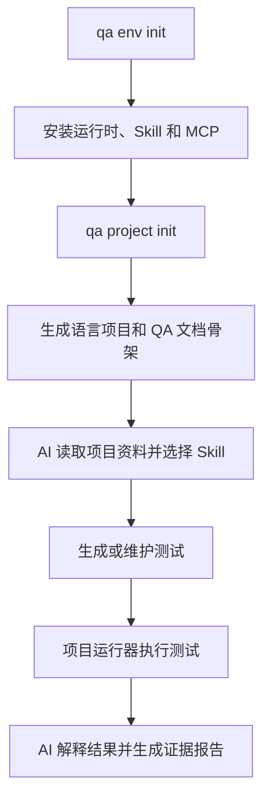

# AI 测试整体模型

[使用人员](../README.md) | [从需求到执行](qa-workflow.zh-CN.md) | [维护人员](maintenance.zh-CN.md)

本页说明 QA + AI + Playwright 的整体工作方式。它回答三个问题：AI 读取什么、如何决定测试动作、如何把结果变成可追踪证据。

## 这套方案解决什么问题

AI 负责理解任务、整理业务规则、选择测试职责、生成或调整测试、执行工具并解释结果。Playwright、pytest、API 客户端和项目运行器负责实际执行。文档和报告负责保存输入、判断和证据。

AI 不凭页面内容猜测业务规则。AI 需要先读取项目规则、需求、接口契约、环境说明和已有测试。缺少关键预期时，AI 将其记录为待确认项，不把假设写成通过结论。

整个系统可以看成四层：

| 层 | 主要问题 | 主要产出 |
| --- | --- | --- |
| 输入层 | 测什么、对谁测、在哪测 | 需求、验收标准、契约、环境、角色和数据基线 |
| 推理层 | 如何拆分范围和选择测试方式 | 业务理解、风险、测试计划、用例和待确认项 |
| 执行层 | 如何实际访问系统并验证 | API/UI/浏览器测试、数据清理和失败证据 |
| 结论层 | 结果是否可信、下一步是什么 | 执行报告、缺陷、覆盖缺口和修复建议 |

## 主流程

下面的流程从上到下表示一次 AI 测试任务的主路径。菱形节点表示需要判断的分支。



## AI 如何选择 Skill 和工具

AI 先按任务类型路由职责，再按语言和环境选择执行方式。Skill 提供规则和边界，MCP、CLI 和测试运行器提供动作能力。

语言实现必须继续读取对应规范：TypeScript 读取 [TypeScript 风格与架构](typescript-code-style.zh-CN.md) 和 `qa-typescript`；Python 读取 [Python 风格与架构](python-code-style.zh-CN.md) 和 `qa-python`。两种语言共用[公共架构与边界](code-style-architecture-common.zh-CN.md)。

| 任务信号 | 先读取的 Skill | 典型动作 |
| --- | --- | --- |
| 不懂业务、流程或角色 | `qa-business-guide` | 整理主流程、状态、角色、异常和问题 |
| 需求、范围、覆盖和用例 | `qa-test-design` | 建立测试计划、用例和追踪关系 |
| 接口、认证、状态码和 schema | `qa-api` | 读取 OpenAPI 或接口资料，设计 API 门禁 |
| 页面、交互和端到端链路 | `qa-web` | 通过 Playwright 检查可观察的页面行为 |
| TypeScript 测试实现 | `qa-typescript` | 使用 Playwright Test、fixtures 和项目脚本 |
| Python 测试实现 | `qa-python` | 使用 pytest、requests 和 pytest-playwright |
| 失败归因和报告 | `qa-triage` | 区分失败类型，记录证据和缺陷 |
| 环境、依赖和运行入口 | `qa-setup` | 检查环境、锁文件、服务和运行条件 |

工具选择遵循验证目标：

- 有明确契约时，先做 API 或契约检查，快速验证认证、参数和响应。
- 需要观察页面行为时，再使用浏览器或 Playwright 验证 UI 状态和交互。
- 需要验证完整业务链路时，组合 API 前置、浏览器操作和结果检查。
- 需要探索未知页面时，可以使用浏览器工具发现路径，但探索结果必须回到可复现用例。
- 需要外部资料时，先登记来源和版本，再读取相关章节。页面内容不能覆盖项目规则。

## 每一步产生什么



项目中的资料位置保持固定：

- `docs/qa/inputs/` 保存需求、契约、环境和外部资料索引。
- `docs/qa/tasks/` 保存一次已经确认的 AI 任务。
- `docs/qa/generated/` 保存业务理解、测试计划、测试用例、执行报告和缺陷。
- `tests/` 保存可复现的自动化实现。
- `test-results/`、`reports/` 和 Trace 保存运行时证据，凭证和敏感数据必须脱敏。

## 测试层级和边界

| 层级 | 验证重点 | 适合发现的问题 | 不能替代的内容 |
| --- | --- | --- | --- |
| 逻辑或单元 | 纯规则、转换和边界 | 计算、状态转换、输入校验 | 服务集成和真实页面行为 |
| API | 认证、参数、状态码、响应和数据变化 | 契约不一致、权限错误、服务规则错误 | 页面渲染和用户操作体验 |
| UI | 页面状态、控件、导航和可观察反馈 | 交互错误、展示错误、浏览器兼容问题 | 未暴露在页面上的完整接口契约 |
| E2E | 跨接口和页面的业务链路 | 集成断裂、角色流程和数据生命周期问题 | 性能、安全和可访问性专项指标 |

性能、安全、可访问性和兼容性属于独立专项。普通功能用例通过，不代表这些专项已经验收。

## 结果如何判定

AI 只根据实际执行和可追踪证据下结论：

- **通过**：实际结果符合已确认的预期。
- **失败**：实际结果不符合预期，且有足够证据定位现象。
- **跳过**：明确未执行，不计入覆盖率。
- **重试后通过**：首次失败，重试成功，并保留首次失败原因和环境信息。
- **未执行**：因为环境、权限、资料或前置条件无法运行。

产品失败、环境失败、测试实现失败和清理失败要分别记录。没有证据时，不宣称业务验收通过。

## 一次任务的最小输入

如果资料不完整，至少先补充以下内容：

- 目标功能和验收标准。
- 测试环境、版本和入口地址。
- 角色、权限、租户和必要数据。
- API 文档或脱敏请求响应样例。
- 允许写入的环境，以及数据清理方式。
- 通过、失败和阻断的判断标准。

输入索引只登记来源、版本和敏感级别，不保存密码、Token、Cookie 或私钥。

## 责任边界和人工确认

AI 可以整理资料、提出假设、生成测试、执行已授权的检查并分析证据。AI 不能自行确认业务规则、扩大生产写入范围、把观察结果当成需求，或在没有执行证据时给出验收通过结论。

| 角色 | 主要责任 | AI 的协作方式 |
| --- | --- | --- |
| 业务负责人 | 确认业务规则、验收标准、角色权限和风险接受 | 确认 AI 标记为待确认的预期 |
| QA 负责人 | 确认范围、层级、门禁、退出标准和证据要求 | 审阅测试计划、覆盖关系和结论 |
| AI 业务分析 | 整理流程、状态、异常和缺口 | 使用 `qa-business-guide` 形成业务理解 |
| AI 测试设计 | 识别风险并设计场景、用例和追踪 | 使用 `qa-test-design` 形成计划和用例 |
| AI 自动化与执行 | 生成或维护测试，运行已授权范围并保存原始结果 | 使用语言 Skill、CLI、MCP 和项目运行器 |
| AI 结果分析 | 分类失败、形成缺陷、报告覆盖和复测范围 | 使用 `qa-triage`，不改变原始结果 |
| 开发负责人 | 修复产品缺陷并提供修复版本 | 接收可复现步骤、预期、实际结果和证据 |
| CI / 发布门禁 | 按项目规则决定是否阻断合并或发布 | 使用报告中的实际状态和证据 |

以下事项必须停在待确认或阻塞状态，不能直接进入通过结论：

- 需求、权限、状态转换或验收标准互相矛盾。
- 测试环境、账号、数据或契约与任务范围不一致。
- 测试需要写入，但授权、隔离或清理方式不可验证。
- 失败没有足够的原始日志、响应、截图或 Trace 支持归因。
- 预期来自 AI 推断，且没有业务或契约依据。

## 需求到证据的追踪

每条重要业务规则都应能沿着下面的链路找到对应的验证结果：

```text
需求 / 业务规则
    ↓
风险与覆盖策略
    ↓
测试场景
    ↓
测试用例
    ↓
自动化实现或人工步骤
    ↓
运行记录
    ↓
日志、响应、截图、Trace 或视频
    ↓
通过、失败、跳过或未执行
    ↓
缺陷、复测或剩余风险
```

项目可以使用需求 ID、规则 ID、用例 ID、运行 ID 和缺陷 ID 建立关联。至少要能回答：哪些需求实际执行过，哪些只是设计了用例，哪些被跳过，哪些失败有缺陷，哪些仍待确认。

## 失败后的处理循环

失败不直接等于产品缺陷。AI 先保留原始结果，再判断问题属于产品、环境、测试实现、数据污染、清理失败或待确认事项。



修复断言、测试数据或环境配置时，必须保留变更依据。需求变更应重新进入业务理解或测试设计；产品修复应进入复测和受影响回归。
## 与 CLI 的关系

CLI 负责准备隔离环境和测试项目。它不替 AI 做业务理解，也不把 AI 的判断硬编码成固定菜单。



CLI、Skill、MCP 和测试运行器的边界见 [Skills 与 MCP](skills-mcp.zh-CN.md)。从需求输入到示例执行的具体命令见 [从需求到执行](qa-workflow.zh-CN.md)。
